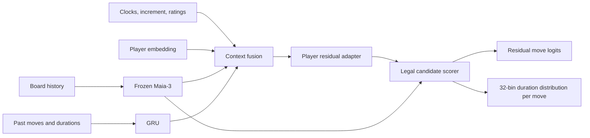

# Chess Personas

Learn a chess player's move preferences and time usage from recorded games.
The initial profiles are **Hikaru Nakamura** (`hikaru`) and **Fabiano Caruana**
(`fabianocaruana`). These are independent, experimental models inspired by their
games; no affiliation or endorsement is implied.

The repository contains a runnable training pipeline, not trained grandmaster
personas. Caruana is a provisional second profile: clock coverage and observed
pace must be audited before calling it a slower model.

## What is implemented

- Sequential, cached Chess.com monthly archive downloads.
- PGN extraction with pre-move clocks, 8-position history and 16-ply move history.
- Whole-game chronological train/validation/test splits, duplicate removal, and
  coverage reports by player and time class.
- Frozen **Maia-3 5M** integration, with its source pinned to a commit.
- A learned embedding and residual adapter for each player, a legal-move scorer,
  and a move-conditioned distribution over 32 duration bins.
- Balanced player sampling, checkpoint selection, and evaluation against the
  frozen base policy. Timing evaluation includes the pre-move marginal prediction.
- Offline prediction CLI, synthetic regression tests, GitHub Actions, and a Colab notebook.

## Quick start

Use Python 3.10 or newer. For local training, create a virtual environment first.
Colab already supplies PyTorch; select a GPU runtime before training.

```bash
python -m pip install -e ".[train,dev]"
python -m pip install -r requirements-maia.txt
```

Start with a modest download and inspect coverage before downloading entire careers:

```bash
chess-personas download hikaru fabianocaruana --max-months 3
chess-personas prepare "data/raw/*/*.json" --output data/processed
chess-personas train --output runs/first --epochs 3 --batch-size 32
chess-personas evaluate runs/first/best.pt --output runs/first/test-metrics.json
```

`download --max-months 0` requests all matching archive months. `--since 2024-01
--until 2025-12` limits the date range. Completed months are cached; the current
month refreshes on each run. Downloaded games and checkpoints are gitignored.

The first Maia training run downloads upstream model weights from Hugging Face.
Use `--checkpoint /path/to/maia3-5m.pt` for an existing checkpoint. A saved persona
checkpoint embeds the backbone weights, so inference does not download them again.

Training defaults to at most 10,000 positions **per player in each split** for an
initial experiment. Set `--max-per-player 0` to use all positions. Missing training
or validation coverage for a configured player is an error rather than silently
training an empty persona. If GPU memory is tight, reduce `--batch-size` to 8.

### Colab

Open [`notebooks/train_colab.ipynb`](notebooks/train_colab.ipynb). It supports a
repository ZIP upload, including for a private repository. It walks through
installation, a small data download, coverage inspection, training, and evaluation.
Download `best.pt`, `config.json`, and `metrics.json` before the Colab session ends.

### Predict a move and duration

```bash
chess-personas predict runs/first/best.pt --record examples/position.json
```

The output includes legal move probabilities, a conditional time estimate for each
candidate, and a timing distribution averaged over all legal moves. Inputs must
describe the position **before** the move. Any `move` or `elapsed_seconds` labels
in an observation are explicitly discarded at prediction time.

## Model



The policy starts exactly at Maia's legal-move distribution. Training learns an
additive correction while a KL penalty anchors it to Maia. The backbone remains
frozen. Duration bins represent the fraction of the remaining clock consumed,
with logarithmic spacing and a near-instant first bin. Predictions are bounded
by the available clock.

See [architecture and data conventions](docs/architecture.md) for losses,
clock assumptions, evaluation metrics, and current limitations.

## Verification

```bash
python -m pytest -q
```

Tests cover increment handling, missing clocks, pre-move feature isolation,
chronological game splits, duplicate games, black promotions, legal masking,
frozen-backbone gradients, checkpoint reloads, and an end-to-end synthetic run.
The `smoke` backbone is deliberately random and exists only to test the software.
It is never substituted silently for Maia.

## Next experiments

1. Audit games and usable timing labels per player, year, and exact time control.
2. Compare both players on matched controls before attributing pace differences
   to player identity. Keep bullet, blitz, and rapid metrics separate.
3. Compare frozen Maia, player adaptation, and adaptation with timing context.
4. Calibrate timing distributions and evaluate playing strength separately.
5. Add an interactive local board or UCI wrapper after validating the model.

## References

- [Maia-3 code and model weights](https://github.com/CSSLab/maia3)
- [Chessformer paper](https://arxiv.org/abs/2605.19091)
- [Maia4All: individual adaptation](https://arxiv.org/abs/2507.21488)
- [Chess.com Published-Data API](https://www.chess.com/news/view/published-data-api)

Upstream Maia is installed separately and retains its AGPL-3.0 license. No upstream
source, game archive, or model weights are bundled in this repository.
